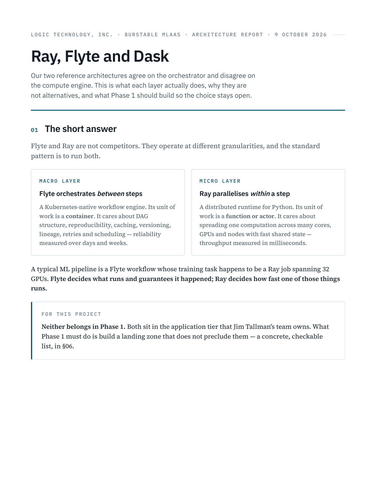
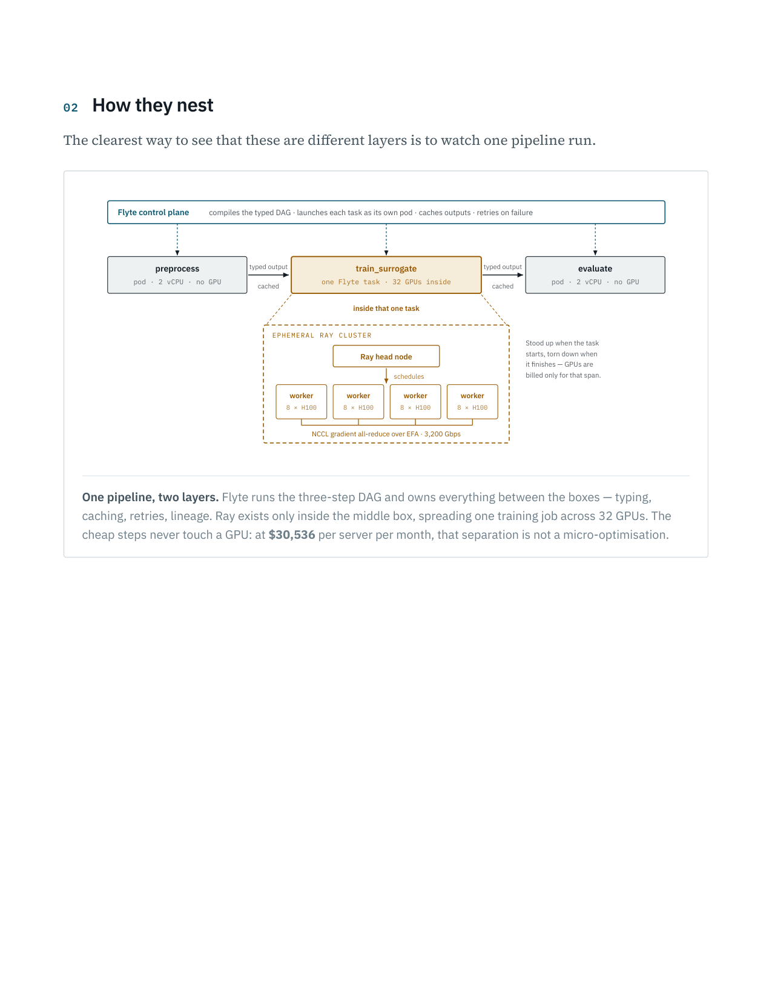
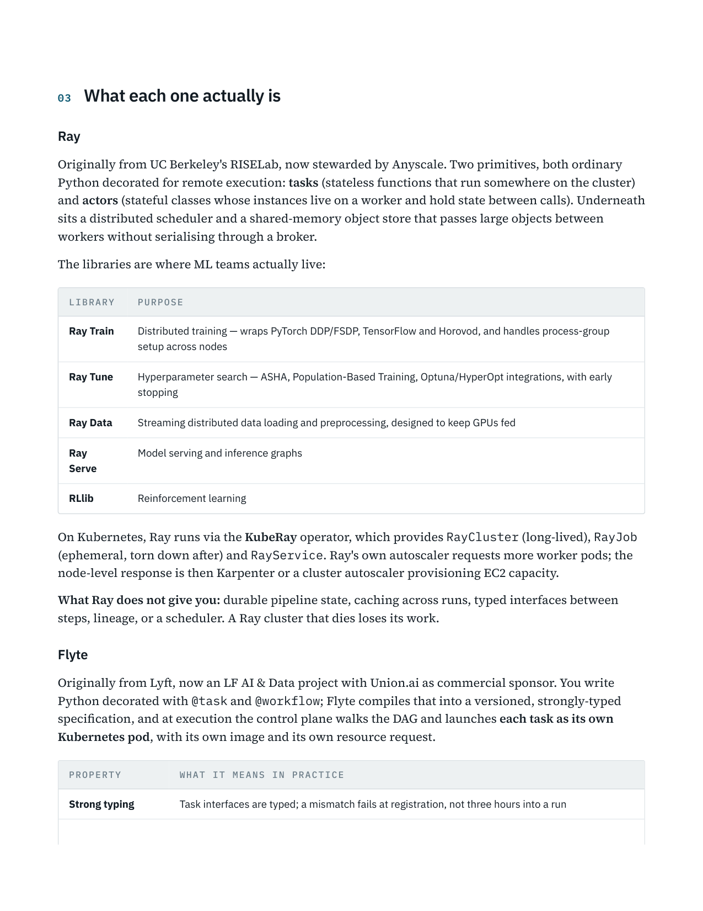
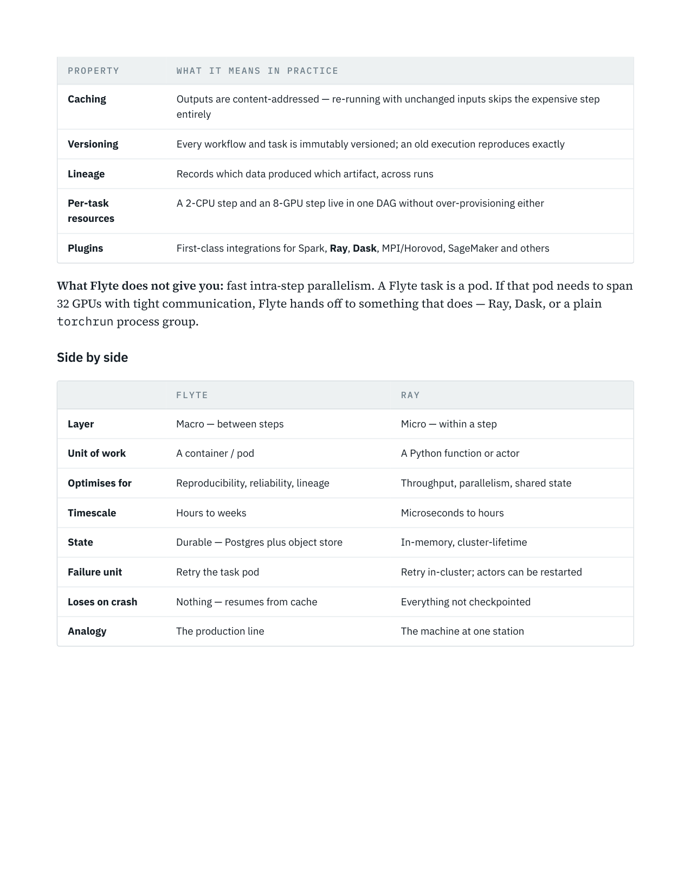
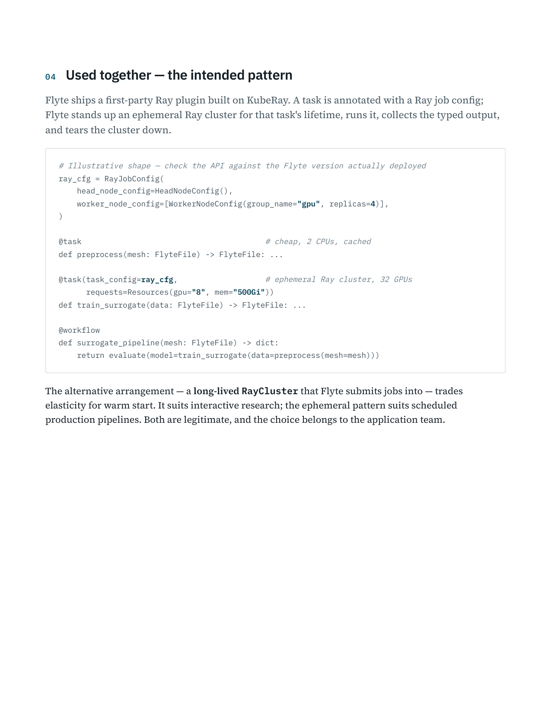
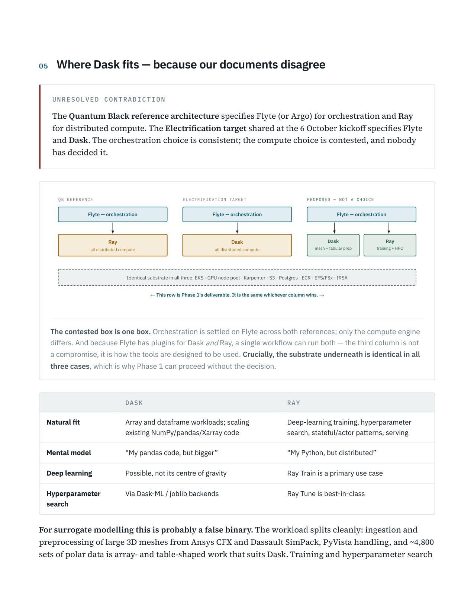
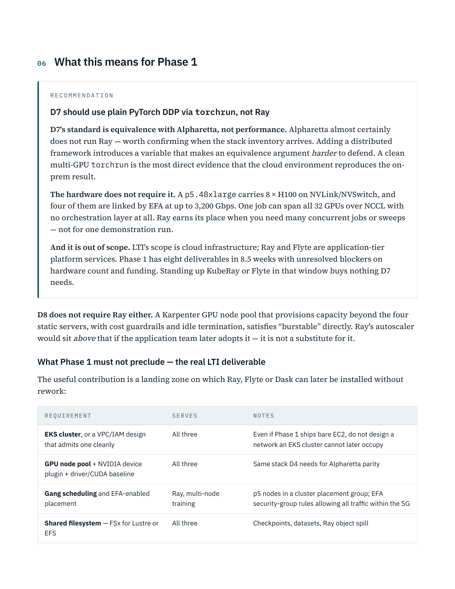
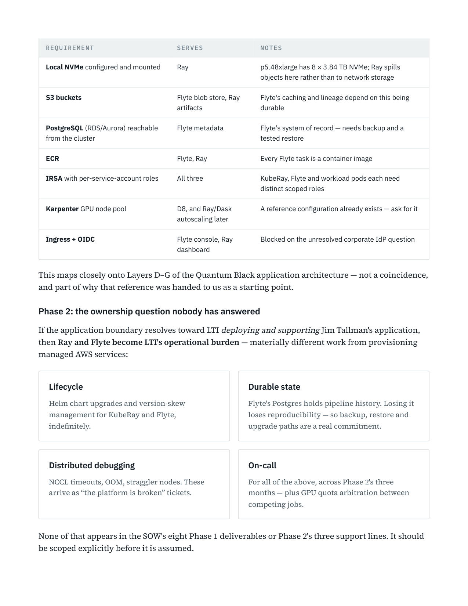
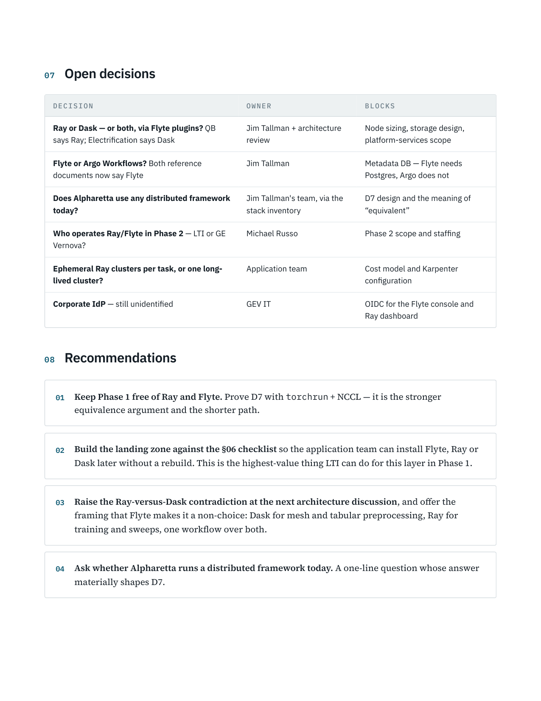
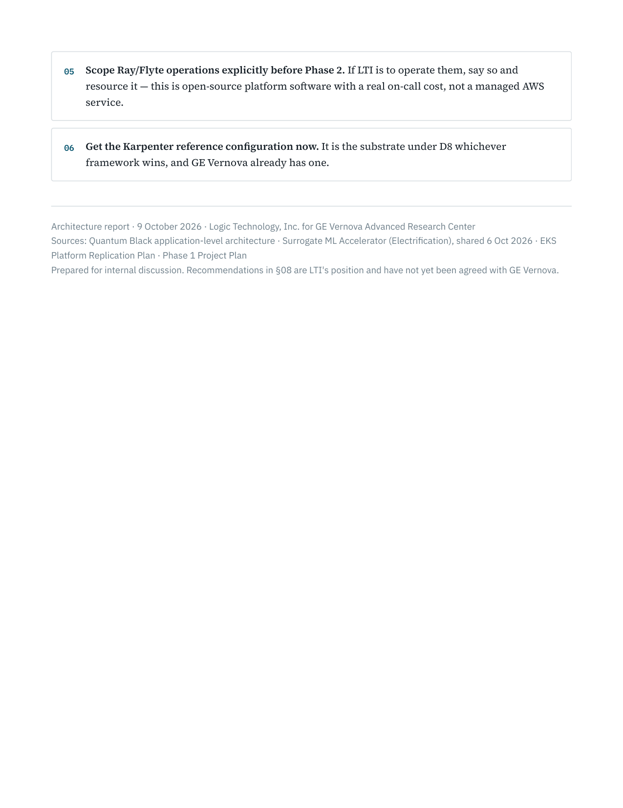

# Ray and Flyte - Orchestration and Distributed Compute

> **TL;DR:** Technical reference exploring how Ray (distributed computation, model training) and Flyte (workflow orchestration, data DAGs) combine in an MLaaS platform.
> **Use this for:** Designing ML workflow engines and distributed task execution architectures.

> **Source:** `memories/Ray and Flyte - Orchestration and Distributed Compute.pdf`
> **Generated:** 2026-10-09 23:51
> **Converter:** `scripts/pdf_to_md.py` (PyMuPDF 1.28.2, dpi=150, render=on)

---

## Page 1



LOGIC TECHNOLOGY, INC. · BURSTABLE MLAAS · ARCHITECTURE REPORT · 9 OCTOBER 2026

Ray, Flyte and Dask

Our two reference architectures agree on the orchestrator and disagree on
the compute engine. This is what each layer actually does, why they are

not alternatives, and what Phase 1 should build so the choice stays open.

01 The short answer

Flyte and Ray are not competitors. They operate at different granularities, and the standard

pattern is to run both.

MACRO LAYER

MICRO LAYER

Flyte orchestrates between steps

Ray parallelises within a step

A Kubernetes-native workflow engine. Its unit of

A distributed runtime for Python. Its unit of

work is a container. It cares about DAG

work is a function or actor. It cares about

structure, reproducibility, caching, versioning,

spreading one computation across many cores,

lineage, retries and scheduling — reliability

GPUs and nodes with fast shared state —

measured over days and weeks.

throughput measured in milliseconds.

A typical ML pipeline is a Flyte workflow whose training task happens to be a Ray job spanning 32
GPUs. Flyte decides what runs and guarantees it happened; Ray decides how fast one of those things
runs.

FOR THIS PROJECT

Neither belongs in Phase 1. Both sit in the application tier that Jim Tallman's team owns. What
Phase 1 must do is build a landing zone that does not preclude them — a concrete, checkable
list, in §06.

## Page 2



02 How they nest

The clearest way to see that these are different layers is to watch one pipeline run.

Flyte control plane
compiles the typed DAG · launches each task as its own pod · caches outputs · retries on failure

typed output

typed output

preprocess

train_surrogate

evaluate

pod · 2 vCPU · no GPU

one Flyte task · 32 GPUs inside

pod · 2 vCPU · no GPU

cached

cached

inside that one task

EPHEMERAL RAY CLUSTER

Stood up when the task

starts, torn down when

Ray head node

it finishes — GPUs are

billed only for that span.

schedules

worker

worker

worker

worker

8 × H100

8 × H100

8 × H100

8 × H100

NCCL gradient all-reduce over EFA · 3,200 Gbps

One pipeline, two layers. Flyte runs the three-step DAG and owns everything between the boxes — typing,

caching, retries, lineage. Ray exists only inside the middle box, spreading one training job across 32 GPUs. The

cheap steps never touch a GPU: at $30,536 per server per month, that separation is not a micro-optimisation.

## Page 3



03 What each one actually is

Ray

Originally from UC Berkeley's RISELab, now stewarded by Anyscale. Two primitives, both ordinary
Python decorated for remote execution: tasks (stateless functions that run somewhere on the cluster)
and actors (stateful classes whose instances live on a worker and hold state between calls). Underneath
sits a distributed scheduler and a shared-memory object store that passes large objects between
workers without serialising through a broker.

The libraries are where ML teams actually live:

LIBRARY
PURPOSE

Ray Train
Distributed training — wraps PyTorch DDP/FSDP, TensorFlow and Horovod, and handles process-group
setup across nodes

Ray Tune
Hyperparameter search — ASHA, Population-Based Training, Optuna/HyperOpt integrations, with early
stopping

Ray Data
Streaming distributed data loading and preprocessing, designed to keep GPUs fed

Model serving and inference graphs

Ray
Serve

RLlib
Reinforcement learning

On Kubernetes, Ray runs via the KubeRay operator, which provides RayCluster (long-lived), RayJob
(ephemeral, torn down after) and RayService. Ray's own autoscaler requests more worker pods; the
node-level response is then Karpenter or a cluster autoscaler provisioning EC2 capacity.

What Ray does not give you: durable pipeline state, caching across runs, typed interfaces between
steps, lineage, or a scheduler. A Ray cluster that dies loses its work.

Flyte

Originally from Lyft, now an LF AI & Data project with Union.ai as commercial sponsor. You write
Python decorated with @task and @workflow; Flyte compiles that into a versioned, strongly-typed
specification, and at execution the control plane walks the DAG and launches each task as its own
Kubernetes pod, with its own image and its own resource request.

PROPERTY
WHAT IT MEANS IN PRACTICE

Strong typing
Task interfaces are typed; a mismatch fails at registration, not three hours into a run

## Page 4



PROPERTY
WHAT IT MEANS IN PRACTICE

Caching
Outputs are content-addressed — re-running with unchanged inputs skips the expensive step
entirely

Versioning
Every workflow and task is immutably versioned; an old execution reproduces exactly

Lineage
Records which data produced which artifact, across runs

A 2-CPU step and an 8-GPU step live in one DAG without over-provisioning either

Per-task
resources

Plugins
First-class integrations for Spark, Ray, Dask, MPI/Horovod, SageMaker and others

What Flyte does not give you: fast intra-step parallelism. A Flyte task is a pod. If that pod needs to span
32 GPUs with tight communication, Flyte hands off to something that does — Ray, Dask, or a plain
torchrun process group.

Side by side

FLYTE
RAY

Layer
Macro — between steps
Micro — within a step

Unit of work
A container / pod
A Python function or actor

Optimises for
Reproducibility, reliability, lineage
Throughput, parallelism, shared state

Timescale
Hours to weeks
Microseconds to hours

State
Durable — Postgres plus object store
In-memory, cluster-lifetime

Failure unit
Retry the task pod
Retry in-cluster; actors can be restarted

Loses on crash
Nothing — resumes from cache
Everything not checkpointed

Analogy
The production line
The machine at one station

## Page 5



04 Used together — the intended pattern

Flyte ships a first-party Ray plugin built on KubeRay. A task is annotated with a Ray job config;

Flyte stands up an ephemeral Ray cluster for that task's lifetime, runs it, collects the typed output,

and tears the cluster down.

# Illustrative shape — check the API against the Flyte version actually deployed

ray_cfg = RayJobConfig(

head_node_config=HeadNodeConfig(),

worker_node_config=[WorkerNodeConfig(group_name="gpu", replicas=4)],

)

@task # cheap, 2 CPUs, cached

def preprocess(mesh: FlyteFile) -> FlyteFile: ...

@task(task_config=ray_cfg, # ephemeral Ray cluster, 32 GPUs

requests=Resources(gpu="8", mem="500Gi"))

def train_surrogate(data: FlyteFile) -> FlyteFile: ...

@workflow

def surrogate_pipeline(mesh: FlyteFile) -> dict:

return evaluate(model=train_surrogate(data=preprocess(mesh=mesh)))

The alternative arrangement — a long-lived RayCluster that Flyte submits jobs into — trades
elasticity for warm start. It suits interactive research; the ephemeral pattern suits scheduled
production pipelines. Both are legitimate, and the choice belongs to the application team.

## Page 6



05 Where Dask fits — because our documents disagree

UNRESOLVED CONTRADICTION

The Quantum Black reference architecture specifies Flyte (or Argo) for orchestration and Ray
for distributed compute. The Electrification target shared at the 6 October kickoff specifies Flyte
and Dask. The orchestration choice is consistent; the compute choice is contested, and nobody
has decided it.

QB REFERENCE
ELECTRIFICATION TARGET
PROPOSED — NOT A CHOICE

Flyte — orchestration

Flyte — orchestration

Flyte — orchestration

Ray

Dask

Dask

Ray

all distributed compute

all distributed compute

mesh + tabular prep

training + HPO

Identical substrate in all three: EKS · GPU node pool · Karpenter · S3 · Postgres · ECR · EFS/FSx · IRSA

← This row is Phase 1's deliverable. It is the same whichever column wins. →

The contested box is one box. Orchestration is settled on Flyte across both references; only the compute engine

differs. And because Flyte has plugins for Dask and Ray, a single workflow can run both — the third column is not

a compromise, it is how the tools are designed to be used. Crucially, the substrate underneath is identical in all

three cases, which is why Phase 1 can proceed without the decision.

DASK
RAY

Natural fit
Array and dataframe workloads; scaling
existing NumPy/pandas/Xarray code

Deep-learning training, hyperparameter
search, stateful/actor patterns, serving

Mental model
“My pandas code, but bigger”
“My Python, but distributed”

Deep learning
Possible, not its centre of gravity
Ray Train is a primary use case

Via Dask-ML / joblib backends
Ray Tune is best-in-class

Hyperparameter
search

For surrogate modelling this is probably a false binary. The workload splits cleanly: ingestion and
preprocessing of large 3D meshes from Ansys CFX and Dassault SimPack, PyVista handling, and ~4,800
sets of polar data is array- and table-shaped work that suits Dask. Training and hyperparameter search

## Page 7


over PyTorch-based neural operators — the NVIDIA mark in the DLS diagram suggests Modulus /
PhysicsNeMo — suits Ray Train and Ray Tune. One Flyte workflow can run both.

## Page 8



06 What this means for Phase 1

RECOMMENDATION

D7 should use plain PyTorch DDP via torchrun, not Ray

D7's standard is equivalence with Alpharetta, not performance. Alpharetta almost certainly
does not run Ray — worth confirming when the stack inventory arrives. Adding a distributed
framework introduces a variable that makes an equivalence argument harder to defend. A clean
multi-GPU torchrun is the most direct evidence that the cloud environment reproduces the on-
prem result.

The hardware does not require it. A p5.48xlarge carries 8 × H100 on NVLink/NVSwitch, and
four of them are linked by EFA at up to 3,200 Gbps. One job can span all 32 GPUs over NCCL with
no orchestration layer at all. Ray earns its place when you need many concurrent jobs or sweeps
— not for one demonstration run.

And it is out of scope. LTI's scope is cloud infrastructure; Ray and Flyte are application-tier
platform services. Phase 1 has eight deliverables in 8.5 weeks with unresolved blockers on
hardware count and funding. Standing up KubeRay or Flyte in that window buys nothing D7
needs.

D8 does not require Ray either. A Karpenter GPU node pool that provisions capacity beyond the four
static servers, with cost guardrails and idle termination, satisfies “burstable” directly. Ray's autoscaler
would sit above that if the application team later adopts it — it is not a substitute for it.

What Phase 1 must not preclude — the real LTI deliverable

The useful contribution is a landing zone on which Ray, Flyte or Dask can later be installed without
rework:

REQUIREMENT
SERVES
NOTES

EKS cluster, or a VPC/IAM design
that admits one cleanly

All three
Even if Phase 1 ships bare EC2, do not design a
network an EKS cluster cannot later occupy

GPU node pool + NVIDIA device
plugin + driver/CUDA baseline

All three
Same stack D4 needs for Alpharetta parity

Gang scheduling and EFA-enabled
placement

Ray, multi-node
training

p5 nodes in a cluster placement group; EFA
security-group rules allowing all traffic within the SG

Shared filesystem — FSx for Lustre or
EFS

All three
Checkpoints, datasets, Ray object spill

## Page 9



REQUIREMENT
SERVES
NOTES

Local NVMe configured and mounted
Ray
p5.48xlarge has 8 × 3.84 TB NVMe; Ray spills
objects here rather than to network storage

S3 buckets
Flyte blob store, Ray
artifacts

Flyte's caching and lineage depend on this being
durable

PostgreSQL (RDS/Aurora) reachable
from the cluster

Flyte metadata
Flyte's system of record — needs backup and a
tested restore

ECR
Flyte, Ray
Every Flyte task is a container image

IRSA with per-service-account roles
All three
KubeRay, Flyte and workload pods each need
distinct scoped roles

Karpenter GPU node pool
D8, and Ray/Dask
autoscaling later

A reference configuration already exists — ask for it

Ingress + OIDC
Flyte console, Ray
dashboard

Blocked on the unresolved corporate IdP question

This maps closely onto Layers D–G of the Quantum Black application architecture — not a coincidence,
and part of why that reference was handed to us as a starting point.

Phase 2: the ownership question nobody has answered

If the application boundary resolves toward LTI deploying and supporting Jim Tallman's application,
then Ray and Flyte become LTI's operational burden — materially different work from provisioning
managed AWS services:

Durable state

Lifecycle

Helm chart upgrades and version-skew

Flyte's Postgres holds pipeline history. Losing it

management for KubeRay and Flyte,

loses reproducibility — so backup, restore and

indefinitely.

upgrade paths are a real commitment.

Distributed debugging

On-call

NCCL timeouts, OOM, straggler nodes. These

For all of the above, across Phase 2's three

arrive as “the platform is broken” tickets.

months — plus GPU quota arbitration between

competing jobs.

None of that appears in the SOW's eight Phase 1 deliverables or Phase 2's three support lines. It should
be scoped explicitly before it is assumed.

## Page 10



07 Open decisions

DECISION
OWNER
BLOCKS

Ray or Dask — or both, via Flyte plugins? QB
says Ray; Electrification says Dask

Jim Tallman + architecture
review

Node sizing, storage design,
platform-services scope

Flyte or Argo Workflows? Both reference
documents now say Flyte

Jim Tallman
Metadata DB — Flyte needs
Postgres, Argo does not

Does Alpharetta use any distributed framework
today?

Jim Tallman's team, via the
stack inventory

D7 design and the meaning of
“equivalent”

Who operates Ray/Flyte in Phase 2 — LTI or GE
Vernova?

Michael Russo
Phase 2 scope and staffing

Ephemeral Ray clusters per task, or one long-
lived cluster?

Application team
Cost model and Karpenter
configuration

Corporate IdP — still unidentified
GEV IT
OIDC for the Flyte console and
Ray dashboard

08 Recommendations

01
Keep Phase 1 free of Ray and Flyte. Prove D7 with torchrun + NCCL — it is the stronger

equivalence argument and the shorter path.

02
Build the landing zone against the §06 checklist so the application team can install Flyte, Ray or

Dask later without a rebuild. This is the highest-value thing LTI can do for this layer in Phase 1.

03
Raise the Ray-versus-Dask contradiction at the next architecture discussion, and offer the

framing that Flyte makes it a non-choice: Dask for mesh and tabular preprocessing, Ray for

training and sweeps, one workflow over both.

04
Ask whether Alpharetta runs a distributed framework today. A one-line question whose answer

materially shapes D7.

## Page 11



05
Scope Ray/Flyte operations explicitly before Phase 2. If LTI is to operate them, say so and

resource it — this is open-source platform software with a real on-call cost, not a managed AWS

service.

06
Get the Karpenter reference configuration now. It is the substrate under D8 whichever

framework wins, and GE Vernova already has one.

Architecture report · 9 October 2026 · Logic Technology, Inc. for GE Vernova Advanced Research Center

Sources: Quantum Black application-level architecture · Surrogate ML Accelerator (Electrification), shared 6 Oct 2026 · EKS

Platform Replication Plan · Phase 1 Project Plan

Prepared for internal discussion. Recommendations in §08 are LTI's position and have not yet been agreed with GE Vernova.


---

## Extracted images

Assets live in the sibling folder `Ray and Flyte - Orchestration and Distributed Compute.md.assets/` and are linked in place above. 11 page(s) rendered; 0 embedded raster(s) extracted.

```text
Ray and Flyte - Orchestration and Distributed Compute.md.assets/p1.png
Ray and Flyte - Orchestration and Distributed Compute.md.assets/p2.png
Ray and Flyte - Orchestration and Distributed Compute.md.assets/p3.png
Ray and Flyte - Orchestration and Distributed Compute.md.assets/p4.png
Ray and Flyte - Orchestration and Distributed Compute.md.assets/p5.png
Ray and Flyte - Orchestration and Distributed Compute.md.assets/p6.png
Ray and Flyte - Orchestration and Distributed Compute.md.assets/p7.png
Ray and Flyte - Orchestration and Distributed Compute.md.assets/p8.png
Ray and Flyte - Orchestration and Distributed Compute.md.assets/p9.png
Ray and Flyte - Orchestration and Distributed Compute.md.assets/p10.png
Ray and Flyte - Orchestration and Distributed Compute.md.assets/p11.png
```
