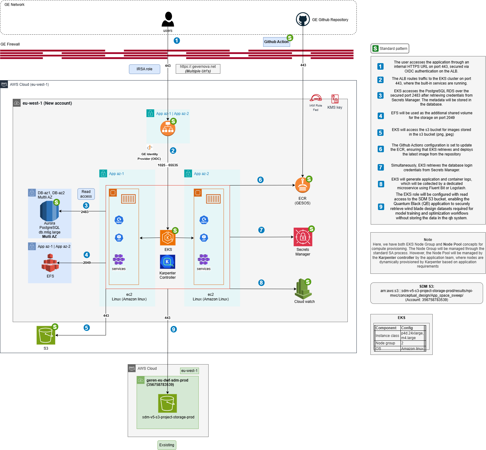
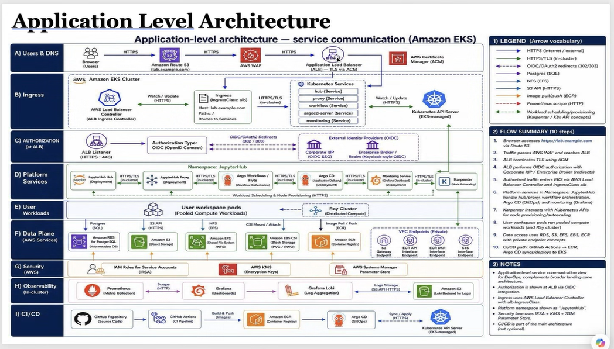
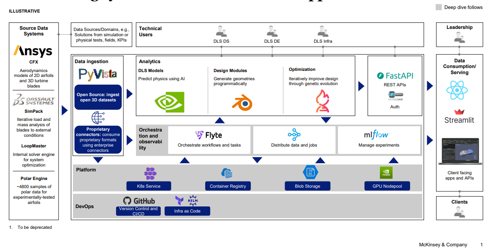

# 📌 Surrogate ML Accelerator — Electrification Project

> **Presentation slides shared by Mike Russo at the GE kickoff on 2026-10-06 detailing business objectives, architecture blueprints, and financial models for Electrification.**
> **Source:** `Projects/Burstable MLaaS/Reference/Surrogate ML Accelerator - Electrification Project.pptx`
> **Generated:** 2026-10-11

## 🎯 TL;DR

- **Business Driver:** Electrification is the first paying customer and funding source for the Burstable MLaaS surrogate modeling accelerator on AWS.
- **Hardware Architecture:** Four dedicated `p5.48xlarge` servers (32 NVIDIA H100 GPUs) deployed in an AWS account within the GE Vernova Enterprise MasterPayer organization with standard security/compliance controls.
- **Reference Blueprint:** Reusing Quantum Black architecture for Kubernetes, storage, and application workflows.
- **Financial Comparison:** Option 1 (On-demand quarterly for 15 months: $1,832,171.52) vs Option 2 (12-month AUF commitment + 3 months on-demand: $1,228,287.79), delivering $603,883.73 in savings.
- **Use this for:** Understanding the business funding context, hardware specifications, and slide visual artifacts for the Electrification surrogate modeling initiative.

---

## Slide 1 — Current State, Objectives & Staffing

### Objective
Bring burstable ML/GPU dense compute capabilities to GEVAR leveraging the AWS cloud — building a scalable solution which can be leveraged as a surrogate model accelerator for the Electrification business.

### Infrastructure (AWS & Run)
- **(4) p5.48xlarge (32 GPUs)** instances deployed in an AWS account hosted in the GEV ENT MasterPayer / Org with all Sec / Compliance controls in place (like QB set up).
- Paid for by **Electrification 2026 Program $'s**.
- Leveraging the **QB design as REFERENCE ARCHITECTURE** and understanding of how the business is currently leveraging our "on prem" environment to design and build out an environment in the cloud to deliver to ELE needs.
- ENG open with CTO/HQ to work with their Solution Architecture team (needed to GWD... called "Base" process).
- Service Now record for "Business App".
- Discussion with AWS to secure P5 instances in planned account.

### Teams
- **ARC DT:**
  - Mike Russo (Sponsor / Block Breaker)
  - Todd Shirback (Project Manager)
  - Dave Garber (Onprem <> Cloud)
  - Nam Park (Cloud Engineer – TBD)
  - Rick Allen (Cloud Engineer – TBD)
  - Chris Burke (Cloud Engineer – TBD)
- **Researchers / Business:**
  - Jim Tallman
  - Deepak Akhare
  - Priyesh Kakka

### Next Steps
- Kick off call with Jim / Business for intake
- Secure funding from business for GPU Servers
- Land Servers in destination account
- Get Nam / Rick AERO badges to work at 1RC (part-time)
- Design of MVP for Jim to GWD
- Meetings with CTO/HQ SA/ENG to get GIT pipelines set up for IaC deployments
- ...etc...

---

## Slide 2 — Product Requirements & Confluence Reference

**Confluence PRD:** [GEVDMND0007346 - Quantum Black - PRD](https://confluence.apps.gevernova.net/devspace/pages/viewpage.action?pageId=358862179&spaceKey=VCA&title=GEVDMND0007346%2B-%2BQuantum%2BBlack%2B-%2BPRD)

---

## Slide 3 — Application Flow & Infrastructure Architecture

---

## Slide 4 — Quantum Black Current Architecture Blueprint

---

## Slide 5 — Financial Analysis & Pricing Options

Surrogate ML Accelerator — Electrification Project Cost Models:

- **Option 1:** 4 dedicated servers hosted in the GEV AWS environment with 32 Nvidia H100 GPUs leveraging "on-demand" costing model including the GEV Customer discount billed quarterly for 15 months.
- **Option 2:** 4 dedicated servers hosted in the GEV AWS environment with 32 Nvidia H100 GPUs paid "all up front" (AUF) for a 12-month commitment and 3 additional months at the "on-demand" costing model prices including all GEV Customer discounts.

### Option 2 Cost Breakdown (12-Month AUF + 3-Month On-Demand)

| Server Count | 12 Month (AUF) Price | Discount % | Discount | Discounted Price | Duration (months) | Cost |
|:---:|:---:|:---:|:---:|:---:|:---:|:---:|
| 4 | $1,134,017.74 | 24% | $272,164.26 | $861,853.48 | 12 | $861,853.48 |

| Server Count | On-Demand Price | Discount % | Discount | Discounted Price | Duration (months) | Cost |
|:---:|:---:|:---:|:---:|:---:|:---:|:---:|
| 4 | $40,179.20 | 24% | $9,643.01 | $30,536.19 | 3 | $366,434.30 |

- **Total Option 2 Cost:** **$1,228,287.79**

### Option 1 Cost Breakdown (15-Month Pure On-Demand)

| Server Count | On-Demand Price | Discount % | Discount | Discounted Price | Duration (months) | Full Cost |
|:---:|:---:|:---:|:---:|:---:|:---:|:---:|
| 4 | $40,179.20 | 24% | $9,643.01 | $30,536.19 | 15 | $1,832,171.52 |

- **Quarterly Cost:** $366,434.30
- **Total Option 1 Cost:** **$1,832,171.52**

### Financial Comparison Summary

- **Option 1 (On-Demand 15 mo):** $1,832,171.52
- **Option 2 (AUF 12 mo + On-Demand 3 mo):** $1,228,287.79
  - AUF 12-Month Cost: $861,853.48
  - 3-Month On-Demand Cost: $366,434.30
- **Option 2 Net Savings:** **$603,883.73** (33% cost reduction)

---

## 🔗 See Also

- [Surrogate ML Accelerator — Electrification](../Architecture/Surrogate%20ML%20Accelerator%20-%20Electrification.md) — Architectural deep dive
- [QB Application-Level Architecture (EKS)](../Architecture/QB%20Application-Level%20Architecture%20(EKS).md) — Service layer analysis
- [QB Reference Architecture](../Architecture/QB%20Reference%20Architecture.md) — Infrastructure topology
- [SOW — Burstable MLaaS](../SOW/SOW%20-%20Burstable%20MLaaS.md) — Master SOW terms
